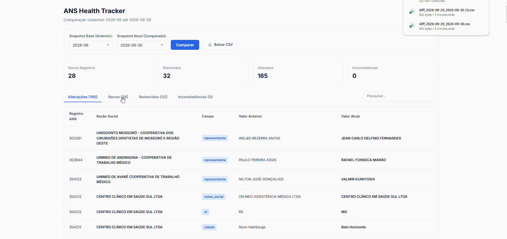

# ANS Health Tracker - Monitoring Brazil's Health-Insurer Registry

> **Live demo:** [web-production-a3f77.up.railway.app](https://web-production-a3f77.up.railway.app/) · [Versão em português](README.pt-BR.md)

<p align="center">
  
</p>

A Python application that monitors, compares and analyzes periodic snapshots of the registry of health-insurance operators published by ANS (Brazil's National Supplementary Health Agency - CADOP).

It ships with a CLI, a FastAPI REST API, a Vue.js web dashboard and an automated GitHub Actions pipeline.

---

## Features

* **Daily automation (GitHub Actions):** a scheduled pipeline checks for and syncs new ANS snapshots every day.
* **Cloud sync (GitHub API):** automatic persistence and recovery of data for cloud environments (Railway, Render, Docker).
* **Historical tracking and comparison:** compares any two recorded periods, identifying added and cancelled operators and changes to registry data.
* **Critical changes and inconsistencies:** alerts on changes to type/status and integrity checks (CNPJ, duplicates, empty fields).
* **Reports and export:** results in the web dashboard, in the terminal (CLI) and as standardized CSV downloads.

---

## Project structure

```text
.
├── .github/
│   └── workflows/
│       └── daily_sync.yml    # Daily automation via GitHub Actions
├── data/
│   └── snapshots/            # Historical CSV snapshots
├── static/
│   └── index.html            # Vue.js web interface
├── analyzer.py               # Analysis engine and inconsistency validation
├── api.py                    # FastAPI server and web routes
├── comparator.py             # Diff between periods
├── config.py                 # Global settings
├── fetcher.py                # Download and ANS version detection
├── github_sync.py            # Data sync via the GitHub API
├── loader.py                 # Loading and sanitizing with pandas
├── main.py                   # Command-line interface
├── models.py                 # Domain dataclasses
├── reporter.py               # Terminal and CSV reports
├── requirements.txt          # Project dependencies
├── .env.example              # Example environment variables
├── .gitignore
└── README.md
```

---

## Getting started

### 1. Install dependencies

```bash
pip install -r requirements.txt
```

### 2. Environment variables (optional)

For remote sync via the GitHub API, create a `.env` file:

```env
GITHUB_TOKEN=your_personal_token_here
GITHUB_REPO=ronaldodfilho/ANS-TRACKER-PY
```

### 3. Run from the terminal (CLI)

Compare against the latest ANS release:

```bash
python main.py 2026-06 --exportar
```

Compare two specific periods:

```bash
python main.py 2026-06 2026-09-30 --exportar
```

### 4. Run the web interface (FastAPI + Vue.js)

```bash
python api.py
```

Open `http://localhost:8000` in your browser.

---

## GitHub Actions automation

The `.github/workflows/daily_sync.yml` workflow runs every day at **08:00 BRT** (11:00 UTC) and saves new snapshots to `data/snapshots/` only when the official dataset has changed.

---

## Author

Ronaldo Dutra Filho
